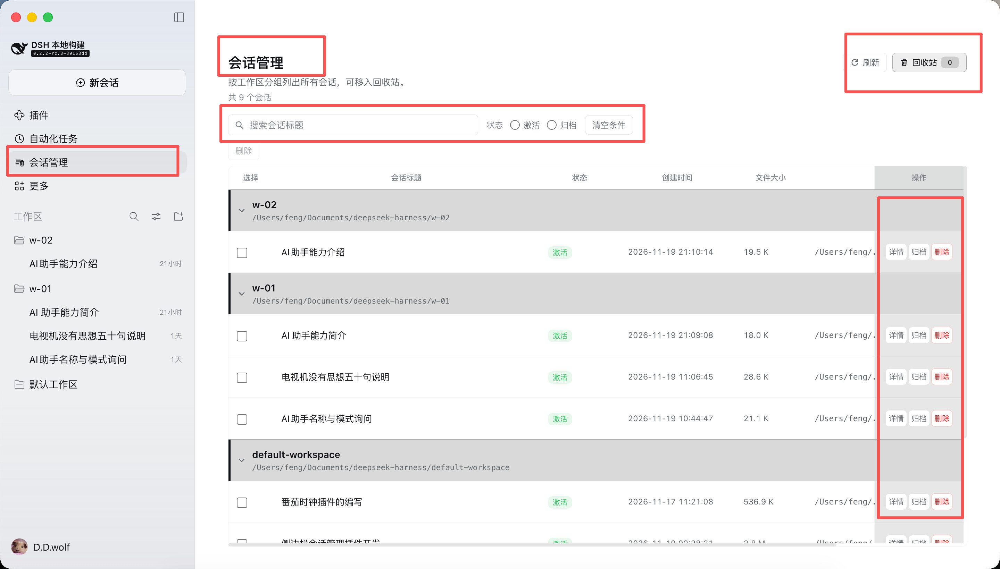
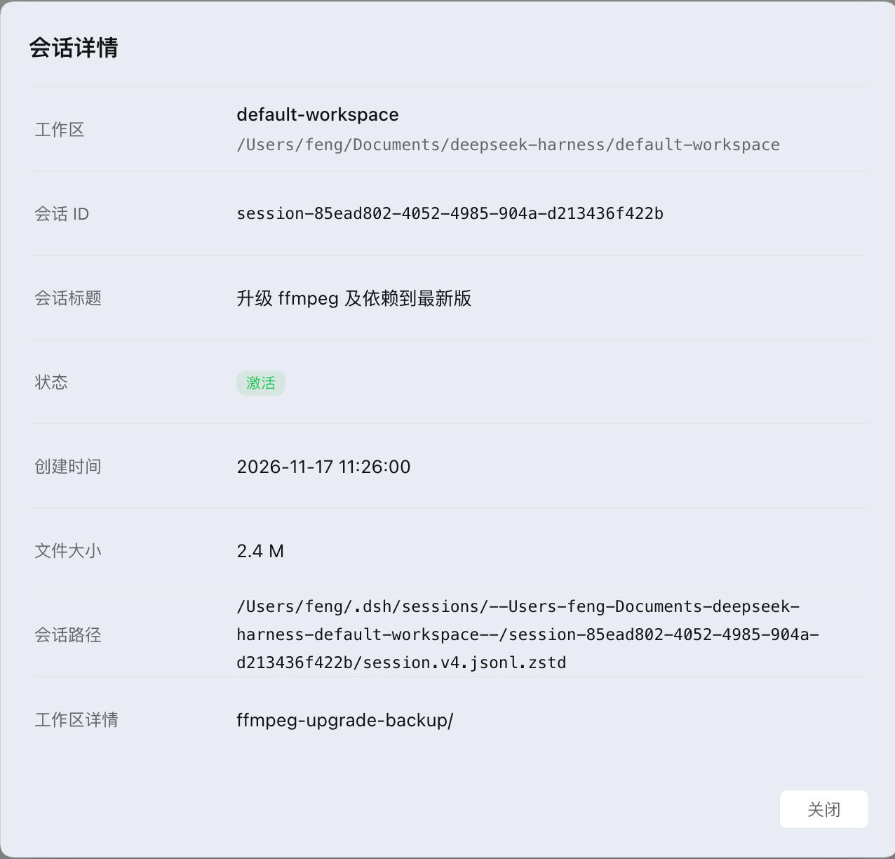

# 会话管理

安装在 DeepSeek Harness 左侧边栏的会话管理插件。点击侧边栏图标打开，按工作区分组管理会话。

*主界面：按工作区分组展示会话，支持搜索、筛选、折叠和批量操作。*

*详情页：双击会话行，查看完整会话信息和工作区详情。*

## 基本操作

1. **查看会话**：主界面按工作区分组列出会话；工作区名称下方显示目录路径。点击工作区分组行可折叠或展开该组。表格列包括选择、标题、状态、创建时间、文件大小、会话路径和操作；回收站额外显示删除时间。
2. **选择会话**：勾选行首复选框。选中行会高亮，表格左上方按钮显示选中数量。
3. **删除到回收站**：勾选后点击主界面左上方的「删除」；未选择时按钮不可用。会话文件会移入插件内的 `trash/<会话ID>/`。
4. **还原**：在回收站勾选会话后点击「还原」；文件放回原路径并重新挂回原工作区。原工作区不存在时放入默认工作区。
5. **彻底删除**：在回收站勾选后点击「删除」，在弹窗中输入 `DELETE`，再点击「确认」。此操作不可恢复；点击「取消」只关闭弹窗。
6. **查看详情**：点击行内「详情」，或双击会话行。窗口依次显示工作区、会话 ID、标题、状态、时间、大小、路径和工作区详情。
7. **归档/激活**：主界面每行「详情」和「删除」之间；激活状态显示「归档」，归档状态显示「激活」，点击切换。
8. **查看回收站**：点击右上角「回收站」；点击「返回会话列表」回到主界面。

## 搜索

- 标题：输入框模糊匹配，带联想提示。
- 状态：用单选框选择「激活」或「归档」。
- 「清空条件」同时清空标题和状态，恢复全部数据。
- 主界面和回收站均支持。

## 注意事项

- 有运行中任务的会话不能删除，请先停止任务。
- 回收站会话会从客户端会话列表中过滤，避免出现「未分组」；该过滤不使用归档状态。
- 回收站数据保存在插件目录的 `trash/` 下，每个条目以会话 ID 命名，并带有 `trash-meta.json` 元数据。
- 插件只修改自身 `trash/` 目录和 DSH 会话存储，不手动编辑 `workspace.json`。
